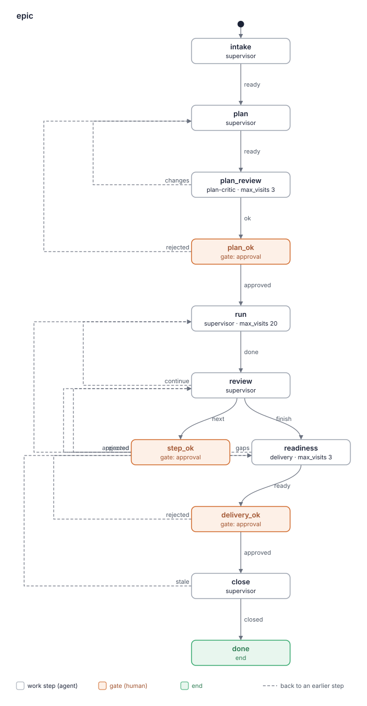

# Blueprint: epic

`epic` takes a feature (an "epic") from a free-form statement to a delivered result. It
checks the statement is ready, asks the human what is missing, plans small verifiable
steps, runs each step as a run of the flow `task` of the kit `sdlc` in the same session,
reviews every step's results and revises the plan, and ends with a release-readiness check
and a report of the decisions that matter. The human talks to one lead, approves the plan, each next
step whose review changed the plan, and the delivery, and keeps every gate of `sdlc`; the
lead gives a recommendation on each of them with the epic's context and records the
decisions that matter. A short living `status` shows where the epic stands at any time.
The kit writes no product code: `sdlc` does.

Started as `lado start <product repo> --kit epic --kit sdlc --kit <tracker kit>`.

## 1. Requirements

Sources: the human's answers in session `kit-epic` (interview rounds 1–3, artifacts
`create/epic/research` and `create/epic/critique`), `docs/brief.md` and
`journal/docker-install.md` (observations "набл." 1–23) of the repository `ladohq/kit-epic`.
Since 0.2.0 also tracker task LAD-145 (the first real run on epic LAD-116, 21–25.10.2026:
its requirements "LAD-145 R<n>" and retro), the analysis `lad-145-analysis` and the
human's answers in session `kit-epic` (#1526, #1570).

- **R1** A feature comes as a free-form statement, from one line to a full specification.
  Before any development the kit assesses how complete it is against a checklist of topics
  and asks the human what is missing, in rounds. *Source:* human, answer to #6566 (V1);
  round 3, Q2.
- **R2** When the statement lacks the data to plan, the first step is a research step (a
  `task` run that produces a research document with checks and difficulties, as LAD-52 did);
  a small feature gets a plan of one step. *Source:* round 3, Q2; journal "Цикл" 1.
- **R3** The plan is a list of small steps, each with its check; a walking skeleton comes
  early. Rolling wave: only the next step (or two, R14) becomes a tracker task; the rest
  stays a plan line. *Source:* brief "Процесс" 1–3; journal "Цикл" 2–3; research §3.
- **R4** Before the human sees the plan, a fresh reviewer looks for gaps and contradictions
  in the statement, the research and the plan. *Source:* brief "Процесс" 2; journal
  "Цикл" 2.
- **R5** The human decides the open questions. A decision gets its own row (who took it,
  on whose recommendation, whether it was taken) when the human did not take the
  recommendation, when it changed the plan, the frame, the concept or the order, or when
  it is a rejection at a gate; approvals as recommended are one counter line per step
  with the gate and question IDs; questions about the process ("can it run in parallel",
  "where are we") are not recorded unless the human confirms an answer as a rule. The log
  is the base of the final report and of later autonomy: the counter keeps the share of
  recommendations taken. *Source:* brief "Процесс" 2 ("Decisions taken"); human V9;
  critique §5; round 3, Q1; LAD-145 R10 (113 rows, about 20 that matter), #1570.
- **R6** Each step: the lead drafts the tracker task and its brief; on the human's yes it
  creates the task through the tracker abstraction (any tracker kit) and starts a run of
  `task` of `sdlc` in the epic's session, so each task starts with fresh workers.
  *Source:* human V3, V4; critique §4; brief "Процесс" 4.
- **R7** A step's brief carries the step's frame (what is in and out), its check, every
  conditional decision as a measurable threshold, and the human's standing rules: manual
  check instructions in the pull request from the start (branch, folder, commands,
  expected result, `env | grep` and `unset`); at every widening ask "a step or a new
  task?"; tasks born in the step are created by the step on the human's yes with a
  derived link; the plan and the epic's files are the epic's, the step leaves them alone;
  the step names its leftovers at the end; no global destructive commands on the human's
  machine; the human's main checkout is never switched. *Source:* brief "Правила человека";
  набл. 6, 10, 16, 17.
- **R8** On every gate and question of a step's run the lead gives a recommendation with
  the epic's context (plan, decisions, earlier steps); the human answers. A gate rejection
  that quotes a recommendation reaches the worker whole. A question of the lead about a
  defect gives what is wrong, then why it is built so (the root and its history), then
  the options and the recommendation. *Source:* critique §4–5; round 3; набл. 7; LAD-145
  R4 (#1428 → #1434).
- **R9** The epic sees a step's end without the human saying "merged", and reviews the
  step from fixed sources: the openspec proposal's "Out of scope", the review ledger's
  "Not checked" and declined findings, the integrator's tracker comment, the run's
  messages with the human and its leftovers, the run's artifacts, and `git log` of the base
  branch since the last review (changes outside the epic). *Source:* набл. 2, 4, 21, 22;
  journal "Где лежат итоги шага".
- **R10** After every step the plan is revised with the known techniques (record the
  result; carry leftovers into future steps; merge, split, reorder steps; replace a patch
  with a change of approach; add to "Later"; check against the human's future plans;
  re-check scope after a decision taken mid-way; compare decided figures with measured
  ones). When the revision changes the plan, it and the next step go to the human
  together (R18). The plan's changes reach the base by a pull request the lead merges
  itself after green CI only at `plan_ok` and at `close`; in between the lead pushes the
  run's branch at every gate and every step without a gate, so nothing is lost; a change
  of the product's release checklist goes by pull request at once, so it reaches a
  release between steps. *Source:* brief "Процесс" 6; набл. 3; journal T2, T7, "Вне
  шага"; LAD-145 R9 option (a) (15 plan pull requests with full CI), #1526.
- **R11** The plan, the decisions log and the epic's state live in the product repository,
  `docs/epics/<key>/`. The lead reads the state at every start and resume without a
  pointer from the human; step numbers of the plan and tracker keys are different spaces.
  *Source:* round 3, Q1; набл. 13, 15, 20.
- **R12** A step can be done with a check open until an event (a release); the plan shows
  it and the lead reminds the human at that event. A release between steps: bring the
  base branch into open pull requests, check the CHANGELOG version, move post-merge checks
  into the product's release checklist. Advice the human did not take moves its risk into
  the release checklist. *Source:* набл. 9, 14, 19, 23; journal T6b.
- **R13** The branch strategy is chosen when the epic starts: by default every step merges
  into the base branch and leaves the product working, unfinished parts hidden; on the
  human's choice an epic branch, into which the lead brings the base branch after every
  step, merged into the base by a final pull request. Choosing the epic branch is the
  human's yes to the lead creating it on the remote and pushing the base into it after
  every step; the question at intake says so. *Source:* round 3, Q3; research §4.4;
  triage of `improve/epic`, answer to #5 (F12.2, F12.3).
- **R14** One step at a time by default; two at once only on the human's yes and only when
  they touch different files; merges one at a time, each after its branch has the latest
  base. *Source:* round 3, Q4; human V8.
- **R15** The epic ends with a release-readiness step: the results of all steps, what was
  checked by hand, what is missing, an upgrade from the previous version with the user's
  old files, open checks moved into the release checklist, and a final report with the
  decisions that matter (R5). Releasing, or merging the epic branch, is the human's decision. *Source:*
  round 3, Q5; human V9, V10; набл. 18.
- **R16** The kit never works in the human's main checkout and never runs global
  destructive commands (`docker system prune`, `docker volume prune`, `rm -rf` outside its
  folders). *Source:* набл. 8, 12.
- **R17** The kit uses `sdlc` as it is and writes no product code. *Source:* brief "Что
  делает кит"; human, answer to #6566.
- **R18** After a step's review that did not change the plan, the next approved plan step
  starts without a gate: the human's approval of the plan at `plan_ok` covers creating
  the tracker tasks of its steps and starting them while the plan stays as approved, and
  the gate's question says so. A change is a step added, dropped, split, merged or
  reordered; a changed frame or check of the next step; a leftover carried into the next
  step; a new question for the human; the human's "pause". Statuses, "Later" and
  leftovers into later steps are not. The lead's note lists each kind with "no". Any
  change opens `step_ok`. *Source:* LAD-145 R1 (`step_ok` 13 of 13 approved without a
  comment); #1570, answer 1.
- **R19** The human sees where the epic stands without asking: a short artifact `status`
  (phase; steps N of M; the current step and its run; what waits for the human, with a
  link; open checks; the next action), rewritten at every move of the epic run and every
  start and end of a step's run, built from the plan's State and `flow_status`. The lead
  writes to the human only: at the start of an epic, with one line on who does what
  after `plan_ok` (the lead writes only the epic's files, `sdlc`'s workers write the code
  through their gates, the critic and `delivery` come for their step and go); one line
  per ended step (its pull request, and whether the next step started without a gate or
  waits at `step_ok`); one line on a long step at its next event when the human has had
  no line for about an hour and nothing waits for them; and when the epic waits for the
  human in a way no gate or question shows. Asked "where are we", the lead points to
  `status`. *Source:* LAD-145 R2, R3, R5 (89 messages of the lead, "где мы" asked three
  times); human #1526 ("периодическое информирование … чтобы он мог вмешаться"); #1570,
  answer 4.
- **R20** A plan step is one run of `task`. A step must be split when it has more than one
  capability the user will see, changes a data schema or file format together with the
  interface, has parts that can merge separately each leaving the product working, or
  cannot be designed in one round of the analyst's questions; the plan critic reports
  such a step as blocking, and a step the review adds follows the same rule. *Source:*
  LAD-145 R6 (7 steps became 14, every L step split at design); #1526.
- **R21** The release side is in the steps' checks from the start: each checklist topic is
  "covered by S<n>, Check: <line>" or "not relevant: <why>"; a step that changes a data
  schema or file format has the way back in its check (rollback to the previous version,
  what stays, how it is checked); a step that changes what the user sees has "the docs
  describe what was built" in its check. The plan critic reports a gap in any of them as
  blocking. *Source:* LAD-145 R7 (rollback of the 31 → 35 migration first checked at
  readiness: G1, S8, S9, LAD-144).
- **R22** The epic's own numbering never goes into the product: step numbers, "not built
  yet (step S<n>)" and links to `docs/epics/` stay out of its code, docs, specs and UI;
  the review of a step and `delivery` look for the plan's step numbers in the diff.
  *Source:* LAD-145 R8 ("not built yet (step S6)", decision #1408, step S8).
- **R23** The review of a step that changed what the user sees checks whether anyone ran
  it by hand; when nobody did, the lead recommends a manual check to the human, with the
  project's recipe when it has one. The lead runs no mandatory check of its own: running
  the product would load the lead's context (набл. 13, 20), and the isolation recipe is
  the project's (for LADO: LAD-147). *Source:* LAD-145 R11, analysis; #1570, answer 3.
- **R24** A later readiness visit marks each earlier gap RESOLVED or STILL OPEN and checks
  what changed on the base since the last visit; the full upgrade and rollback run again
  only when the change touches migrations, the update, the install or the user's files.
  *Source:* LAD-145 R12; #1526.

Decisions of the interview recorded here:
- A step is a run of `task` in the epic's session, not a separate session (critique §4,
  accepted 2026-10-18): no LADO change is needed, a run's end reaches the lead.
- Gates are not delegated to the lead in this version; autonomy is earned by data
  (R5, R8) and asked of LADO later (critique §5).
- Both `epic` and `sdlc` have a supervisor, so LADO's built-in supervisor leads with the
  lead skills `lead-epic` and `lead-sdlc` (LADO 0.40.0, `kits.py`); this is intended.
- `close` may send the result back to `readiness` (`stale`) when the approved result
  cannot be merged as it is; accepted at the triage of `improve/epic` (answer to #5,
  report `kit-reports/epic-0.1.0-2026-10-18.md`, F3.1).
- The pushes to an epic branch get no gate of their own: the human's choice of the
  strategy at intake covers them, so the gates stay at three (F12.2, F12.3).
- The run's branch is never reset: the base is merged into it after the plan pull request
  of `run` (a fast-forward), before `readiness` and in `close` before the closing pull
  request, with the conflict rule of `epic-files`, so no decision row is lost (F12.1 of
  0.1.0; F3.1 of the 0.2.0 re-evaluation).
- The epic-branch option stays unverified in 0.1.0 (README, "Known limit"); an explicit
  target branch for `sdlc` is a backlog item of this repository, not a part of this kit.
- R18 is a third outcome of `review` (`continue: run`), not a conditional gate: the flow
  engine has none, and one is asked of LADO only if the outcome proves awkward (backlog of
  this repository). Open runs of 0.1.0 keep their flow: LADO runs a run on the snapshot
  of its flow taken at its start. The loop `run` → `review` → `run` without a gate needs a
  limit (`lado kits check`): `run` has `max_visits: 20`, counting started steps (LAD-116
  had 14). At the limit LADO asks the human `continue` or `cancel`, and from then on before
  every further step, which is the 0.1.0 behaviour of a gate per step; the lead says so at
  the limit and recommends `continue`. On `run`, not `review`, so rejections at `step_ok`
  and returns from `readiness` do not use it up (decided by the supervisor at the
  second triage; the human approves it at `plan_ok`).
- `status` is an artifact, not a file of the product: it changes at every move, and a
  commit for each would be noise; what must survive a lost context is already in the
  plan's State, from which the lead rebuilds `status`.
- Out of this kit (#1526, #1530): the changes to `sdlc` (a second `merge_ok` only when the
  code changed, questions only by card) are LAD-146; the isolated instance for manual
  checks of LADO is LAD-147.

## 2. Starting point

The transferred process of the Docker epic (`journal/docker-install.md`, "Цикл, как он
сложился"; `docs/brief.md`, "Процесс"), in the human's words and owners:

| # | Step | Owner | Hands on | Read later by |
|---|---|---|---|---|
| 1 | Research | sdlc task | research document | plan review |
| 2 | Review of research, plan, decisions | epic lead; human decides | plan, "Decisions taken" | every step |
| 3 | Step: draft task → yes → tracker task → brief → start | epic lead; human says yes | tracker task, brief | step's analyst |
| 4 | Step runs `task` (design gate, merge gate, manual check) | sdlc; human at gates | merged PR, ledger, tracker comment | review |
| 5 | Review of the step from fixed sources | epic lead | plan edits, next draft | human |
| 6 | Plan revision by PR, merged after green CI | epic lead | plan | next step |
| 7 | Release readiness before the release | epic lead, asked by the human | release checklist | human |

Changed in the transfer, with the human's agreement:
- Step 3–4: a run in the epic's session instead of `start_session` (critique §4); the
  human's "merged" message is gone (R9).
- Step 1: the readiness check of the statement comes first (R1); research is a plan step
  when needed (R2).
- Step 2: the review becomes an independent reviewer's step (R4).
- Steps 5–6: the human's yes on the revision and the next step is one gate (as in the
  journal, "предлагает правки плана и черновик следующей задачи; да человека").
- Step 7: always the last step, by a worker, before the human's delivery decision (R15).

```yaml
name: epic
start: intake
states:
  intake:
    agent: supervisor
    outcomes: {ready: plan}
  plan:
    agent: supervisor
    outcomes: {ready: plan_review}
  plan_review:
    agent: plan-critic
    max_visits: 3
    outcomes: {ok: plan_ok, changes: plan}
  plan_ok:
    gate: approval
    outcomes: {approved: run, rejected: plan}
  run:
    agent: supervisor
    max_visits: 20
    outcomes: {done: review}
  review:
    agent: supervisor
    outcomes: {continue: run, next: step_ok, finish: readiness}
  step_ok:
    gate: approval
    outcomes: {approved: run, rejected: review}
  readiness:
    agent: delivery
    max_visits: 3
    outcomes: {ready: delivery_ok, gaps: review}
  delivery_ok:
    gate: approval
    outcomes: {approved: close, rejected: readiness}
  close:
    agent: supervisor
    outcomes: {closed: done, stale: readiness}
  done:
    end: true
```



How the loop runs: `plan_ok` approves the plan and its first step; `run` carries the
approved step(s) out and ends when their `task` runs end; `review` reviews them, revises
the plan and drafts the next step: when the review changed nothing of the plan (R18) it
reports `continue` and the next step starts, otherwise `step_ok` approves it; when no step is left,
`review` reports `finish` and the delivery worker checks readiness. A gap found there goes
back to `review` as a new step.

## 3. Traceability

| Element | Kind | Covers | Why it exists / why nothing simpler |
|---|---|---|---|
| `supervisor` | role (lead) | R1, R5, R6, R8, R9, R10, R11, R12, R13, R14, R16, R18, R19 | Leads the epic. In a session with `sdlc` it is the built-in lead's skill `lead-epic`. First action at every start and resume: read `docs/epics/<key>/plan.md` ("State") and `flow_status` (R11). Recommends on every gate of the step runs with the epic's context and records the outcome in the decisions log (R5, R8). Keeps `status` and writes to the human only on the events of R19. Makes plan changes only in the epic run's worktree (R16). Starts `task` runs only for steps the human approved. |
| `plan-critic` | role (read-only) | R4, R20, R21 | A fresh look at the brief, research and plan: gaps, contradictions, steps without a check, steps to split (R20) as blocking, checklist topics without a step and its check line, a migration without its way back, a visible change without docs (R21), overlap of parallel steps, the checklist topics of `epic-files` not covered. The lead wrote the plan, so its own review is not independent (critique §2.1). Writes no file; `read_only: true`. |
| `delivery` | role | R15, R13, R22, R24 | The release-readiness check needs a fresh context and runs things (an upgrade from the previous version with old files, the product's checks), and for an epic branch brings the base in and resolves conflicts: work the lead must not carry in its context (набл. 13, 20). Commits the report and, on an epic branch, the merge of the base. |
| `epic` | flow | R1–R17 | The epic's whole life in one run, so `flow_status` always says where the epic is after a lost context (набл. 20). |
| `epic.intake` | work step | R1, R2, R13 | Reads the statement, assesses it against the checklist of `epic-files`, asks the human in rounds, settles the branch strategy and the epic's key. Produces `epic-brief` (the statement as clarified, the readiness verdict, the answers). |
| `epic.plan` | work step | R2, R3, R5, R14 | Writes the plan (steps with checks, walking skeleton first, research first when needed, parallel candidates marked) and the first step's draft task and brief. Produces `plan` and `step-brief`; on a later visit reads `plan-review` and the human's reason. |
| `epic.plan_review` | work step | R4 | Reads `epic-brief`, `plan`, `step-brief`; produces `plan-review`; `changes` sends it back. `max_visits: 3`: after three rounds the human decides. |
| `epic.plan_ok` | gate | R5, R6, R18 | Only the human decides the plan and its open questions, and that approving it lets the lead start its steps without `step_ok` while the plan stays as approved (R18); reads `epic-brief`, `plan`, `plan-review`, `step-brief`. |
| `epic.run` | work step | R6, R7, R8, R10, R12, R13, R14, R18, R19 | `max_visits: 20`: the gate-less loop with `review` needs a limit; at it the human answers before each further step. On its first visit after a gate or a `continue`: after `plan_ok` merges the approved plan change (pull request from the epic run's worktree, after green CI), otherwise pushes the run's branch (R10); writes the step's tracker key into `plan.md` and commits it as soon as the task exists, before starting its run; creates the step's tracker task(s) with `tracker`, starts the `task` run(s) with the brief, recommends on their gates, keeps `status` (R19), and handles a release that happens meanwhile. Done when every started `task` run ended (LADO tells the lead). Produces nothing: the results are in the step runs' artifacts, which `review` reads. |
| `epic.review` | work step | R9, R10, R12, R13, R14, R18, R22, R23 | Reviews the ended step(s) from the fixed sources of `step-review`, revises the plan, records decisions, brings the base into an epic branch, drafts the next step. Produces `retro`; writes `plan` and `step-brief` again. `continue` → `run` when nothing of the plan changed (R18), with each kind of change marked "no" in the note; `next` → `step_ok`; `finish` when no step is left. |
| `epic.step_ok` | gate | R6, R10, R14, R18 | Creating a tracker task leaves the machine, and the human said "создать задачу" and "запустить" are theirs (brief, "Точки человека"); since 0.2.0 only when the review changed the plan: the human's yes at `plan_ok` covers the unchanged steps (R18, #1570); reads `retro`, `plan`, `step-brief`. |
| `epic.readiness` | work step | R15, R22, R24 | Produces `delivery-report`; `gaps` sends a missing step back to `review`. `max_visits: 3`. |
| `epic.delivery_ok` | gate | R15 | Releasing or merging the feature is only the human's; reads `delivery-report`, `plan`. |
| `epic.close` | work step | R13, R15 | On an epic branch merges the final pull request the human approved; marks the plan closed, links the report, closes the epic's tracker item when it has one. `stale` sends it back to `readiness` when the approved result cannot be merged as it is (the epic branch moved on, the closing pull request's CI is red from the work): the lead may neither fix product code nor force-push, so a fresh readiness check, bounded by its `max_visits`, rebuilds the result and the human approves it again (critic's F3.6). |
| `epic-files` | skill | R1, R3, R5, R10, R11, R12, R15, R19, R21 | The formats every role shares: `docs/epics/<key>/` with `brief.md`, `plan.md` (State on top; steps with check, status — including "done, check open until X" — tracker key, run; "Later"), `decisions.md` (date, question, options, recommendation and by whom, decision and by whom, taken or not), `report.md`, the artifact `status` (R19); the readiness checklist of topics, each covered by a step and its check line (R21) (goal and "done", users, scope and limits, data and migrations, secrets, update and rollback, removal, platforms, observability, tests, documentation). Three roles read them, so one place. |
| `step-brief` | skill | R6, R7, R14, R20, R22 | How to write a step's tracker task and brief: the frame, the check, thresholds, the human's standing rules of R7 and the rule of R22, parallel steps' file sets. The lead's know-how for one step kind, kept out of its prompt. |
| `step-review` | skill | R9, R10, R12, R13, R18, R22, R23 | The fixed sources and where each is, the plan-revision techniques with their journal examples, what counts as a change of the plan (R18), the manual-check source (R23), the numbering search (R22), recurring traps between steps, the release-between-steps routine, bringing the base into an epic branch. |
| `tracker` | skill of another kit (expects) | R6, R15 | Creates and reads the step tasks on any tracker; `expects.skills`, brought by a tracker kit (e.g. `tracker-yougile`), as `sdlc` does. |
| `sdlc-settings` | skill of another kit (expects) | R13, R17 | The project's base branch, epic branch naming, code host and its CLI, chat language, from `.lado/sdlc.md`; `expects.skills`, brought by `sdlc`. Using it, not a copy, keeps one source of the project's settings and makes a session without `sdlc` fail to start, which is right: the steps need `sdlc`. |
| `git` | command (expects) | R10, R13 | The lead and `delivery` run it on every project (plan pull requests, bringing the base in); `expects.commands`. The code host and its CLI (e.g. `gh`) come from `sdlc-settings` (**Git**), which `epic-files` names (F11.1). |

The flow `task` of `sdlc` is not part of this kit; its README gives the start command
with `--kit sdlc` and `--kit <tracker kit>`.

Reverse check:
- R1: intake, `epic-files`, supervisor
- R2: intake, plan
- R3: plan, `epic-files`
- R4: plan-critic, plan_review
- R5: plan_ok, plan, supervisor, `epic-files`
- R6: run, step_ok, plan_ok, `step-brief`, `tracker`, supervisor
- R7: run, `step-brief`
- R8: run, supervisor
- R9: review, `step-review`, supervisor
- R10: review, step_ok, run, `step-review`, `epic-files`
- R11: supervisor, `epic-files`
- R12: run, review, `step-review`, `epic-files`
- R13: intake, run, review, delivery, close, `step-review`, `sdlc-settings`, `git`
- R14: plan, run, review, step_ok, `step-brief`
- R15: delivery, readiness, delivery_ok, close, `epic-files`
- R16: supervisor
- R17: `sdlc-settings`, README
- R18: review, run, plan_ok, step_ok, `step-review`, supervisor
- R19: supervisor, run, `epic-files`
- R20: plan-critic, plan_review, `step-brief`
- R21: plan-critic, plan_review, `epic-files`
- R22: `step-brief`, review, `step-review`, delivery, readiness
- R23: review, `step-review`
- R24: delivery, readiness

Known limit to verify when building: `sdlc` 0.5.0 targets an epic branch only "when the
tracker has epics and the task's epic has a branch on the remote" (`agents/analyst.md`).
With a tracker without epics, R13's epic branch needs the run's task to name the target
branch and the analyst to take it; if `sdlc` does not, the author reports it and the
epic-branch option waits for a change to `sdlc`.

## 4. Complexity budget

Output of the `kit-budget` script on version 0.2.0 (the build of `improve/epic-2`).

| Measure | Where | Value | Zone | Reason, when not green |
|---|---|---|---|---|
| Worker roles (not supervisor) | kit | 2 | green | |
| Work steps in a flow | flows/epic.yaml | 7 | yellow | intake (R1) and plan (R3) are separate so a lost context resumes at the right one (набл. 20); plan_review is the independent check (R4); run and review are the step loop (R6, R9, R10); readiness (R15) needs a fresh worker; close (R13, R15) acts only after the human's delivery decision, which a gate cannot do. |
| Gates in a flow | flows/epic.yaml | 3 | yellow | plan_ok (R5), step_ok (R6, R18: creating a tracker task and starting a step are the human's, brief "Точки человека"; since 0.2.0 it opens only when the review changed the plan), delivery_ok (R15: the feature's release or merge is the human's). Each guards a different decision; merging them would make the human approve a step without its plan revision or a delivery without its report. |
| Words in a role prompt | agents/delivery.md | 594 | green | |
| Words in a role prompt | agents/plan-critic.md | 376 | green | |
| Words in the lead's prompt | agents/supervisor.md | 994 | green | |
| Own skills | kit | 3 | green | |
| MCP servers | kit | 0 | green | |

Similar paragraphs: none. Overall: yellow.

## 5. Change log

| Date | Version | Change | ← Fact (session, run, metric or report) |
|---|---|---|---|
| 2026-10-18 | 0.1.0 | `close` gets the outcome `stale: readiness`, with its condition in `close`, `step-review` "At close" and the exception in `epic-files` "When a command fails" | `kit-reports/epic-0.1.0-2026-10-18.md`, F3.1 |
| 2026-10-18 | 0.1.0 | `git reset --keep` only right after the plan pull request merged and with no unmerged commit, else merge the base; never at readiness; the run's remote branch is deleted after the plan pull request merged; `delivery` checks the base on a detached `origin/<base>` | same report, F12.1, F3.3, F4.1 |
| 2026-10-18 | 0.1.0 | The intake question on the branch strategy names creating the epic branch on the remote and the push after every step | same report, F12.2, F12.3 |
| 2026-10-18 | 0.1.0 | Plan changes from a thematic audit wait for the next gate's plan pull request; a paused epic reports `next` with no new step; a later `readiness` marks earlier gaps RESOLVED or STILL OPEN | same report, F5.1, F3.2, F8.1 |
| 2026-10-18 | 0.1.0 | How to find the epic's folder after a lost context; duplicated rules replaced by references; the code host's tool from `sdlc-settings` | same report, F2.1, F6.1, F6.2, F6.3, F11.1 |
| 2026-10-25 | 0.2.0 | `review` gets `continue: run`: the next step starts without `step_ok` when the review changed nothing of the plan (R18); `plan_ok`'s question says so | LAD-145 R1; #1570 |
| 2026-10-25 | 0.2.0 | Artifact `status` and the lead's messages only on the events of R19, a line per ended step and on a long step about hourly; replaces "Progress" (old R8) | LAD-145 R2, R3, R5; #1526; `kit-reports/epic-0.1.0-2026-10-25.md`, F9.1 |
| 2026-10-25 | 0.2.0 | Plan pull requests only at `plan_ok` and `close`, a push of the run's branch in between, the release checklist at once (R10) | LAD-145 R9 (a) |
| 2026-10-25 | 0.2.0 | `decisions.md` keeps rows only for decisions that matter, a counter for approvals as recommended (R5) | LAD-145 R10; #1570 |
| 2026-10-25 | 0.2.0 | Steps to split and the release side in the steps' checks, blocking for the plan critic (R20, R21); the epic's numbering stays out of the product (R22) | LAD-145 R6, R7, R8; report F3.1, F4.1, F12.3 |
| 2026-10-25 | 0.2.0 | The review checks whether a visible change was checked by hand (R23); a later readiness focuses on the gaps and the base's diff (R24); root first in the lead's defect questions (R8) | LAD-145 R11, R12, R4; #1570 |
| 2026-10-25 | 0.2.0 | The other findings of the full assessment, among them the open ones of 0.1.1 (F3.2, F7.1, F2.6, F6.1, F8.1) | `kit-reports/epic-0.1.0-2026-10-25.md`; #1570, answer 5 |
| 2026-10-25 | 0.2.0 | `run` gets `max_visits: 20`: the loop `run` → `review` → `run` via `continue` has no gate, and `lado kits check` requires a limit | author's `build-report` of `improve/epic-2` |
| 2026-10-25 | 0.2.0 | The run's branch is never reset; the base is merged in after the plan pull request, before `readiness` and in `close`; `plan_ok`'s question names the release checklist's own pull requests | `kit-reports/epic-0.2.0-2026-10-25.md`, F3.1, F12.1, F5.3 |
