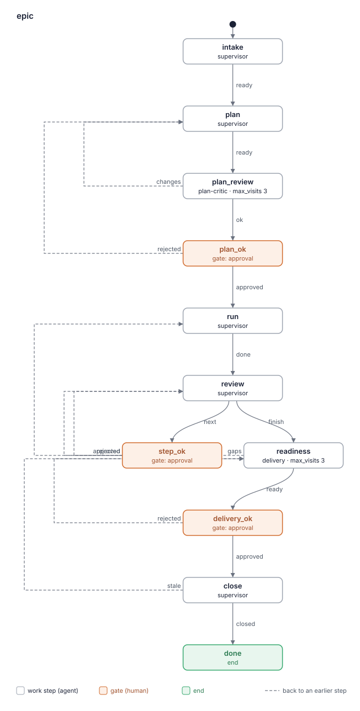

# Отчёт о ките: epic 0.1.0

- Дата: 2026-10-18
- Кит: корень worktree прогона `improve/epic` (`.lado/worktrees/kit-epic/improve-epic`), путь дан шагом
- Коммит: e9b37a0
- Оценил: критик kit-builder (слои a и b)
- Режим: полная оценка. Задача предлагала взять отчёт `kit-reports/epic-0.1.0-2026-10-19.md`. Шаг `assess` разрешает это, только если текст кита не менялся после коммита, который этот отчёт оценивал. Тот отчёт оценивал dfa7483, а после него текст кита менялся: c2b452f (`flows/epic.yaml`, три навыка) и 3ecf851 (`BLUEPRINT.md`). Поэтому прежний отчёт здесь служит только фоном, а кит оценён заново.
- Проходы: три полных прохода по всему киту и зависимым навыкам. Зависимости: `sdlc-settings`, `lead-sdlc` (`agents/supervisor.md` кита sdlc 0.5.0), `tracker` (tracker-yougile 0.4.0) и flow `task`. Каждый проход делал свежий независимый субагент: проход 1 начинал с kit.yaml и ролей, проход 2 — с flow, проход 3 — с навыков. Прежнего отчёта у субагентов не было. Слияние, сверку цитат и проверку находок одного прохода критик провёл сам. Находки одного прохода: отброшено 6, оставлено как подтверждённые 4.

Находки — кандидаты, которые взвешивает человек. Это не оценка «сдал / не сдал».

## Карточка

| Слой | Результат |
|---|---|
| a. `lado kits check` | OK; 0 предупреждений |
| a. Бюджет | жёлтый: шагов в flow 7, гейтов 3. Обе меры обоснованы в BLUEPRINT.md, раздел 4 |
| a. Flows | нарисован 1; 1 расхождение со скелетом чертежа (у `close` нет исхода `stale`) |
| b. Рубрика | 14 находок (2 high, 6 medium, 6 low); без находок 4 критерия из 12 (1, 7, 9, 10) |
| Охват | полная оценка всего кита, 9 файлов (kit.yaml, README.md, BLUEPRINT.md, 3 роли, 1 flow, 3 навыка) |

Счёт относится только к тому, что названо в строке «Охват». Его нельзя сравнивать со счётом повторной оценки.

### `lado kits check .`

```
epic: OK (2 agents, 3 skills, 0 packs and 1 flows)
read-only roles: plan-critic
expects skills: tracker, sdlc-settings
expects commands: git
```

Expects: `expects skills: tracker, sdlc-settings`, `expects commands: git`.

Read-only: `read-only roles: plan-critic`; `dependencies.lado: ">=0.34"`.

### Скрипт бюджета (код выхода 0)

```
# Complexity budget: epic 0.1.0

| Measure | Where | Value | Green / yellow up to | Zone |
|---|---|---|---|---|
| Worker roles (not supervisor) | kit | 2 | 3 / 5 | green |
| Work steps in a flow | flows/epic.yaml | 7 | 5 / 8 | yellow |
| Gates in a flow | flows/epic.yaml | 3 | 2 / 3 | yellow |
| Words in a role prompt | agents/delivery.md | 539 | 800 / 1500 | green |
| Words in a role prompt | agents/plan-critic.md | 344 | 800 / 1500 | green |
| Words in the lead's prompt | agents/supervisor.md | 760 | 1000 / 1500 | green |
| Own skills | kit | 3 | 5 / 10 | green |
| MCP servers | kit | 0 | 2 / 4 | green |

## Similar paragraphs (one rule, one place; 55% similar or more)

none

Overall: yellow
```

### Flows



```
flow epic: state close, outcome stale: none, planned readiness
1 difference(s) from BLUEPRINT.md
```
(код выхода 1)

## Исправить в первую очередь

1. Добавить `close` исход `stale: readiness`, как в чертеже, с условием в `do`, и указать на него из step-review «At close» и из исключения в epic-files «When a command fails» (F3.1, расхождение `--compare`).
2. Ограничить `git reset --keep origin/<base>`: только сразу после слияния PR плана и только если на ветке прогона нет коммитов, которых нет в базе. Иначе он молча стирает строки `decisions.md` и правки `review` (F12.1). Сюда же относятся F3.3 и F4.1.
3. Push в ветку эпика после каждого шага идёт без гейта и без «да» человека. Назвать его при выборе стратегии в `intake` или перенести за `step_ok` (F12.2).
4. Тематический аудит плана: сказать, как правка попадает в базу без гейта (F5.1).
5. «Wait for `sdlc`» ставит эпик на паузу, но в `review` нет пути для паузы (F3.2).

## Находки

### 1. Границы ролей

Без находок. Права каждой роли названы: `agents/plan-critic.md:12` «You change no file and commit nothing: your result is the artifact», `agents/delivery.md:11-12` «you change no / product code beyond resolving that merge's conflicts, and push nothing», `agents/supervisor.md:15-16` «you write the epic's files under `docs/epics/<key>/` and the product's release checklist».

### 2. Передача между шагами

- **F2.1** [low] `agents/supervisor.md:27`
  > 2. For each open `epic` run, read `docs/epics/<key>/plan.md` ("State" first) and
  `flow_status` даёт имя прогона (`epic-<slug>`), а не ключ эпика. До шага `plan` файла `plan.md` нет вовсе: `flows/epic.yaml:50` «Write `docs/epics/<key>/plan.md` … from `epic-brief`». В `docs/epics/` при этом лежат и прошлые эпики. После потери контекста в `intake` или `plan` ведущему приходится угадывать папку.
  Fix: «the folder whose `plan.md` State names this run (`Epic run:`), or the key in the run's `epic-brief`; before `plan`, read `brief.md`». Passes: 1/3, confirmed. Обе цитаты на месте, и `plan.md` пишется только в `plan`.

### 3. Когда шаг готов и какой исход

- **F3.1** [high] `flows/epic.yaml:200` (state `close`), с `skills/step-review/SKILL.md:91`
  >     outcomes: {closed: done}
  >   refused because the epic branch moved, tell the human; the readiness check is out of
  Кит сам называет проверку готовности устаревшей, но у `close` один исход. `close` отсылает отказ push к `epic-files`, «When a command fails», а там (`:106-107`) «a refused push or merge … is no / outcome and no gap»: ведущий ждёт человека и повторяет, и повтор отклонят так же. Красный CI закрывающего PR (ветка эпика → база) по вине работы не покрыт вовсе: `:102` говорит только «A red CI on a plan pull request, or a red check at» readiness. Ведущему нельзя ни править код продукта, ни делать force push. Прогон застревает в `close`, пока кто-то не сделает `lado flow-set` руками. Это и есть расхождение, которое печатает `--compare`: в чертеже `stale: readiness` есть, во flow нет.
  Fix: `outcomes: {closed: done, stale: readiness}`. В `do` шага `close` написать «Report `stale` when the push of the readiness branch is refused because the epic branch moved, or the closing pull request's CI is red from the work; note_body the command and its output». В step-review «At close» заменить «tell the human» на «report `stale`». В epic-files «When a command fails» добавить исключение для этих двух случаев. Passes: 3/3.

- **F3.2** [medium] `skills/step-brief/SKILL.md:74` (state `review`, `flows/epic.yaml:146`)
  >   step back to "planned" and pause the epic in the plan's State until `sdlc` takes an
  Когда прогон шага отменён, `run` сообщает `done`, и flow идёт в `review`. Но у `review` только `outcomes: {next: step_ok, finish: readiness}`, а его `do` ничего не говорит про эпик на паузе. Ведущий либо снова набросает тот же шаг для `step_ok`, либо ошибочно сообщит `finish`, и от прогона к прогону выбор будет разный.
  Fix: в `review` написать: на паузе ведущий пишет `retro` и State с паузой, сообщает `next` без нового шага и в note говорит, что `step_ok` ждёт `sdlc` (или что человек отменит прогон). Passes: 2/3.

- **F3.3** [medium] `flows/epic.yaml:104` (state `run`), с `skills/epic-files/SKILL.md:106`
  >       1. Merge the approved plan change: push the run's branch, open its pull request to
  > push or merge, branch protection, a flaky CI run, a host past its time ceiling) is no
  Предположим, PR плана слит через squash или rebase. Тогда после `git reset --keep origin/<base>` (F12.1) ветка прогона расходится со своей копией на remote, если хост её не удалил. Push на следующем гейте будет non-fast-forward, и его отклонят. `epic-files` относит «a refused push» к причинам вне работы, так что ведущий будет останавливаться и звать человека на каждом шаге из-за сбоя, который создаёт сам кит. Это известная дыра 1 наоборот.
  Fix: в «Changing the files» написать: после слияния PR плана удалить удалённую ветку прогона (или пушить только её с `--force-with-lease`). «A refused push» считать причиной вне работы только для чужих веток. Passes: 1/3, confirmed. В тексте кита нет ни способа слияния, ни правила про удалённую ветку прогона: `grep -rn "force\|remote branch\|squash" agents flows skills` находит только `step-review:76` «force-pushing the epic branch».

### 4. Независимая проверка

- **F4.1** [medium] `agents/delivery.md:26-27` (state `readiness`)
  >    check and its evidence. Run the product's checks of **Checks** on what will be
  >    released (the readiness branch, or the base), with their numbers.
  Для ветки эпика `step-review` даёт точные команды. Для стратегии по умолчанию (база) ничего не говорит delivery, как получить `origin/<base>`. Ветку прогона в последний раз ставили на базу после слияния PR плана в `run`, то есть до слияния кода последнего шага. Независимая проверка и обновление «to the new build» могут пройти на дереве без последнего шага и всё равно дать `ready`.
  Fix: «On the base: `git fetch origin`, `git switch --detach origin/<base>`, check there, then `git switch <the run's branch>` before writing the report». Passes: 1/3, confirmed. `grep -n "switch\|detach\|origin/<base>" agents/delivery.md` ничего не находит, а F12.1 запрещает решать это через reset.

### 5. Противоречия

- **F5.1** [medium] `agents/supervisor.md:83`, против `skills/epic-files/SKILL.md:92`
  >   the plan on their yes, as a plan change.
  >   The lead pushes and opens it only after the human's yes at a gate, waits for green CI
  При тематическом аудите «да» человека приходит в чате, а правку плана разрешено пушить только «after the human's yes at a gate». Ведущий либо пушит и сливает правку сразу, вне гейта, либо держит её до следующего гейта. Если прогон эпика ждёт на `step_ok`, артефакт `plan` у гейта устаревает.
  Fix: «commit it in the epic run's worktree and write `plan` again; it reaches the base with the next gate's plan pull request». Passes: 3/3 (влияние medium по проходу 1, проходы 2 и 3 дали low и medium).

### 6. Дублирование

- **F6.1** [low] `flows/epic.yaml:134` (state `review`)
  >       When a step is left, draft it (or two, only when they touch different files) with
  Копия правила из `skills/step-brief/SKILL.md:57` «Only when the human asked for it and the plan marks both as candidates whose `Touches`», и копии уже расходятся: в `review` нет условия «the human asked for it».
  Fix: «(two only as `step-brief` says, "Two steps at once")». Passes: 2/3.

- **F6.2** [low] `agents/supervisor.md:46`
  > switch its branch there; the one exception is the fast-forward pull `lead-sdlc` makes
  Повторяет `skills/epic-files/SKILL.md:118` «The human's checkout stays on its branch, untouched, except the fast-forward pull».
  Fix: оставить правило в «Safety on the human's machine», а в роли — ссылку на него. Passes: 2/3.

- **F6.3** [low] `agents/supervisor.md:47`
  > after a run, on its conditions. Every role of this kit keeps the safety rules of `epic-files`.
  Другие роли не читают промпт ведущего, а у delivery есть своя ссылка (`agents/delivery.md:52`: «rules of `epic-files` and remove only what you created, by name.»). Это правило для чужих ролей, которое ничего не меняет.
  Fix: удалить фразу. Passes: 2/3 (проход 1 отнёс к критерию 9, проход 2 — к 6; оставлено 6, потому что исправление то же).

### 7. Когда звать человека

Без находок. Путь к человеку есть у каждого решения: `flows/epic.yaml:83-84` «with each open blocking finding under "Questions for the human": / the human decides it at `plan_ok`»; worker в тупике пишет ведущему (`epic-files:108` «`delivery` sends the command and its whole output to the lead with `send_message` and waits»); у неработающей ветки эпика два варианта для человека (`step-brief:69`). Пауза без пути в flow — это F3.2.

### 8. Циклы при повторном визите

- **F8.1** [medium] `flows/epic.yaml:162` (state `readiness`, `max_visits: 3`)
  >       On a later visit after `gaps` the steps the review added have ended: check again
  `readiness` отправляет работу назад (`gaps: review`), значит это проверяющее состояние в цикле. Но на повторном визите не сказано отметить прежние пробелы как RESOLVED или STILL OPEN. На `delivery_ok` человек не видит, закрыли ли добавленные шаги то, что нашли раньше.
  Fix: «first mark each gap of your previous `delivery-report` RESOLVED or STILL OPEN». Passes: 2/3.

### 9. Краткость и зачем

Без отдельных находок (дубль F6.3 проход 1 относил сюда). Неочевидные правила объясняют себя: `epic-files:15-16` «the lead reads them at every start, so what is not in them is lost with / the lead's context», `epic-files:97-98` «a relative path would show the human an older file». Все промпты в зелёной зоне.

### 10. Описания навыков

Без находок. У каждого навыка сказано «когда», и он отличается от соседа: `step-brief` «for reviewing a step that ended use `step-review`», `step-review` «for drafting the next step use `step-brief`». Каждый навык из `skills:` ролей используется. Кит, который приносит каждый навык из `expects.skills`, назван в README (`README.md:38-41`), `dependencies.lado: ">=0.34"`.

### 11. Нейтральность к провайдеру

- **F11.1** [low] `skills/epic-files/SKILL.md:94`
  >   protection (with `gh`: `gh api repos/<owner>/<repo>/rules/branches/<base>`).
  Ведущий пушит, открывает PR, ждёт CI и сливает, но ни одна строка кита не отсылает к инструменту хоста кода из `sdlc-settings` **Git**. Назван только `gh`. Чертёж (`BLUEPRINT.md:198`) утверждает: «The code host's CLI (`gh`) comes from `sdlc-settings`, checked by the text». Текст этого не делает, а `sdlc-settings` адресует строку **Git** «analyst, developer, integrator», не ведущему. На хосте не GitHub ведущий будет гадать.
  Fix: в «Changing the files» написать «use the code host and its tool from `sdlc-settings` (**Git**)». Passes: 1/3, confirmed. `grep -n "sdlc-settings"` по ролям, flow и epic-files находит только Languages, ключ задачи, шаблон ветки и запись в трекер.

### 12. Безопасность и рамки

- **F12.1** [high] `skills/epic-files/SKILL.md:89`
  >   Before the first change after a merge, put the run's branch on the base: `git fetch origin` and `git reset --keep origin/<base>`.
  Какое слияние имеется в виду, не сказано, и нет условия, что на ветке нет неслитых коммитов. А после слияния PR плана ведущий продолжает коммитить в ветку прогона: `flows/epic.yaml:113` «Mark the step in `plan.md` "in progress" with the key and the run, and commit.», решения гейтов шага (`agents/supervisor.md:57` «worktree when the run moves on.»), а на пути `finish` — правки `review` (`flows/epic.yaml:132`), и PR плана перед `readiness` нет. Слияние PR шага в `task` — тоже «a merge». Ведущий в `review` или delivery перед коммитом отчёта (правило адресовано обоим, `:85-86`) делает reset и молча теряет строки `decisions.md`, переносы в «Later» по слову человека и статусы шагов. R5 называет этот журнал основой итогового отчёта.
  Fix: «Right after the plan pull request merged, and only when `git log origin/<base>..HEAD` lists no commit; otherwise `git merge origin/<base>`. Never reset in `readiness`.» Passes: 3/3.

- **F12.2** [medium] `skills/step-review/SKILL.md:79` (state `review`)
  >   origin/<epic branch>`, `git merge origin/<base>`, `git push origin HEAD:<epic branch>`,
  Push слияния базы в общую ветку эпика на remote идёт после каждого шага, без гейта и без «да». `step_ok` стоит после `review`, и в его ask этого нет. Вопрос о стратегии в `intake` (`flows/epic.yaml:31-36`) тоже не говорит, что ведущий будет так пушить. Отменить такой push можно только revert или force push.
  Fix: назвать эти push в вопросе `intake` о стратегии («the lead brings the base into the epic branch and pushes it after every step»), чтобы выбор человека их покрывал. Либо перенести слияние и push в `run`, после `step_ok`, и назвать их в ask. Passes: 3/3 (влияние medium по проходу 3, проходы 1 и 2 дали low).

- **F12.3** [low] `flows/epic.yaml:107` (state `run`)
  >       2. On an epic branch, when it does not exist on the remote yet: create it from the
  Создание и push ветки эпика не названы в ask `plan_ok` (`flows/epic.yaml:92`: «step? The lead then merges the plan's pull request after green CI, creates the»). Человек одобряет, не зная, что на remote появится ветка.
  Fix: добавить в ask `plan_ok` «on an epic branch, creates and pushes it», или назвать в вопросе `intake`, как в F12.2. Passes: 2/3.

## Известные дыры

| Известная дыра | Находка или как кит с ней справляется |
|---|---|
| 1. Красная проверка возвращается без учёта окружения | в основном решено: `epic-files:102` «First tell whether the work caused it», у delivery «a red / check from outside the work … are not gaps». Остались закрывающий PR (F3.1) и отказ push, который создаёт сам кит (F3.3) |
| 2. Работа вне flow, merge без гейта | каждый merge в базу идёт после `plan_ok`, `step_ok`, `delivery_ok` или явного «да» в step-brief «Switch to the base»; `supervisor.md:70` «Start a run of `task` only for a step the human approved». Исключения: push в ветку эпика (F12.2, F12.3) и правка плана после аудита (F5.1) |
| 3. Путь вне worktree прогона | решено: `epic-files:97` «passes `write_artifact` the absolute path in the epic run's worktree»; `supervisor.md:45` «Your own repository is the human's checkout: read it, never edit»; папка обновления — «under the system's temporary folder» |
| 4. Вердикт без порога важности | решено: `flows/epic.yaml:81-82` «Report `ok` / when no finding is blocking»; `agents/delivery.md:45` «**A gap** is: …» |
| 5. Навык зависимости пишет или спрашивает, где роли нельзя | нет: read-only `plan-critic` не получает `tracker`; правила записи в `epic-files` адресованы «the lead and `delivery`»; delivery пишет только ведущему |
| 6. Команды не совпадают с `expects.commands` | нет: `expects commands: git`, README требует только `git`; `lado` необязателен («without `lado` on PATH, mark it unavailable»), `gh` только условно (см. F11.1) |
| 7. Read-only роли не совпадают с тем, что делают | нет: `read-only roles: plan-critic`, роль «changes no file»; delivery коммитит и не read-only; `lado: ">=0.34"`; README: «the kit does not run on Codex CLI» |

## Не прослежено

- Расхождение `--compare`: `flow epic: state close, outcome stale: none, planned readiness`. Чертёж (коммит 3ecf851) опережает flow. Изменение в чертеже человек ещё не одобрял (см. вопрос 1). Пока расхождение есть, оно блокирует `approved`. Это F3.1.
- `BLUEPRINT.md:198` «checked by the text»: текст этого не делает (F11.1).
- Каждая роль, шаг, гейт и навык названы требованием в разделе 3. Обе жёлтые меры обоснованы в разделе 4.

## Вопросы человеку

1. Исход `close: {closed: done, stale: readiness}` (F3.1) добавлен в чертёж после того, как вы одобрили его на `design_ok`. Принимаете? Рекомендация: да. Это единственный выход из `close`, который не требует ни править код продукта, ни делать force push, и он ограничен `max_visits: 3` у `readiness`.
2. Push в ветку эпика после каждого шага (F12.2): достаточно назвать его в вопросе о стратегии в `intake`, или нужен отдельный гейт? Рекомендация: назвать в `intake`. Гейт добавил бы четвёртый и вывел бы бюджет в красную зону.
3. Вариант «ветка эпика» в 0.1.0 по-прежнему не проверен (README, «Known limit»). Рекомендация: оставить предупреждение и завести задачу на kit-sdlc о явной целевой ветке.

## Найдено по пути

- Расхождение между задачей и шагом: задача говорит «take it, do not evaluate the kit again», а условие шага `assess` при изменённом тексте требует новой оценки. Отчёт следует шагу (см. «Режим»).
