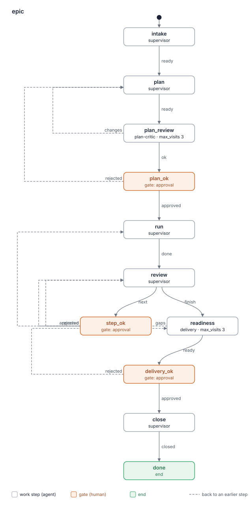

# Отчёт о ките: epic 0.1.0

- Дата: 2026-10-19
- Кит: корень worktree прогона `create/epic` (`.lado/worktrees/kit-epic/create-epic`), путь дан шагом
- Коммит: dfa7483
- Оценил: критик kit-builder (слои a и b)
- Режим: повторная оценка относительно предыдущего отчёта (коммит f419349, кит на 42fe6f6), `git diff 42fe6f6 dfa7483 -- kit.yaml README.md BLUEPRINT.md agents flows skills`
- Проходы: три прохода по изменённому тексту и его окружению. Проход 1 сделал сам критик (начал с ролей). Проходы 2 (начало с flow) и 3 (начало с навыков) сделали свежие независимые субагенты, у которых были diff, предыдущий отчёт, рубрика и зависимые тексты sdlc 0.5.0. Проверку вырезанных правил критик провёл сам после проходов, по `git diff --word-diff` и таблице автора. Полный проход пропущен: в `create` весь кит новый, и три прохода первой оценки уже были полными (`kit-rubric`, «Re-evaluation» 5). Находки одного прохода: отброшено 0, оставлено как подтверждённые 4.

Находки — кандидаты, которые взвешивает человек. Это не оценка «сдал / не сдал».

## Карточка

| Слой | Результат |
|---|---|
| a. `lado kits check` | OK; 0 предупреждений |
| a. Бюджет | жёлтый: шагов в flow 7, гейтов 3. Обе меры обоснованы в BLUEPRINT.md, раздел 4 |
| a. Flows | нарисован 1; совпадает со скелетом чертежа |
| b. Рубрика | 9 находок в изменённом тексте (2 high, 6 medium, 1 low), из них 1 ещё открыта с прошлого раза (F5.2, low). Без находок 7 критериев из 12. Из 15 прежних находок 14 RESOLVED, 1 STILL OPEN |
| Охват | повторная оценка изменённого текста (8 файлов diff) без полного прохода: в `create` весь текст изменён, первая оценка была полной |
| Правило остановки | не выполнено: 2 high, 6 medium. Это совет для гейта релиза, а не запрет |

Счёт относится только к тому, что названо в строке «Охват». Его нельзя сравнивать со счётом полной оценки.

### `lado kits check .`

```
epic: OK (2 agents, 3 skills, 0 packs and 1 flows)
read-only roles: plan-critic
expects skills: tracker, sdlc-settings
expects commands: git
```

Expects: `expects skills: tracker, sdlc-settings`, `expects commands: git`.

Read-only: `read-only roles: plan-critic`; `dependencies.lado: ">=0.34"`.

### Скрипт бюджета (код выхода 0)

```
# Complexity budget: epic 0.1.0

| Measure | Where | Value | Green / yellow up to | Zone |
|---|---|---|---|---|
| Worker roles (not supervisor) | kit | 2 | 3 / 5 | green |
| Work steps in a flow | flows/epic.yaml | 7 | 5 / 8 | yellow |
| Gates in a flow | flows/epic.yaml | 3 | 2 / 3 | yellow |
| Words in a role prompt | agents/delivery.md | 539 | 800 / 1500 | green |
| Words in a role prompt | agents/plan-critic.md | 344 | 800 / 1500 | green |
| Words in the lead's prompt | agents/supervisor.md | 760 | 1000 / 1500 | green |
| Own skills | kit | 3 | 5 / 10 | green |
| MCP servers | kit | 0 | 2 / 4 | green |

## Similar paragraphs (one rule, one place; 55% similar or more)

none

Overall: yellow
```

### Flows



```
same as the plan in BLUEPRINT.md
```
(код выхода 0)

## Исправить в первую очередь

1. `git switch -c readiness/<key>` падает на любом повторном визите `readiness`, а он входит в flow: после `gaps` и после отказа на `delivery_ok`. Ветку надо пересоздавать (`-C`) и после `--abort` возвращаться на ветку прогона (F8.1).
2. У `close` нет пути назад, когда push ветки readiness отклонён или CI закрывающего PR красный по вине работы. Сам кит называет проверку тогда «out of date», а правило «When a command fails» велит просто повторить (F3.6).
3. Продолжение эпика: `intake` всё ещё велит «start `decisions.md`», а `plan` пишет `plan.md` с нуля. Готовые шаги и номера S<n> могут потеряться (F5.8).
4. Правило «When a command fails»: ведущий сам повторяет команду delivery, а delivery ждёт без пробуждения. Это конфликтует с ролью delivery при обновлении, которое нельзя запустить (F5.5, F5.6).
5. Выход из `design_ok`, когда ветка эпика не работает: «once» на шаг или на эпик, и как именно перевести эпик на базовую ветку (F7.1).

## Находки

### 1. Границы ролей

Новых находок нет. Права delivery уточнены: «product code beyond resolving that merge's conflicts, and push nothing». Расхождение с `epic-files` — F5.7.

### 2. Передача между шагами

Новых находок нет. Ответы гейтов теперь пишутся в файл: `flows/epic.yaml:96` «0. Record the answer in `decisions.md`: each open question with its decision, and». `close` reads `delivery-report`, где описаны разрешения конфликтов, которые утверждает гейт.

### 3. Когда шаг готов и какой исход

- **F3.6** [high] `skills/step-review/SKILL.md:88` (state `close`, `flows/epic.yaml:195`)
  > readiness/<key>:<epic branch>`. When the push is refused because the epic branch moved,
  > tell the human; the readiness check is out of date.
  Кит сам говорит, что проверка готовности тогда устарела, но у `close` единственный исход `outcomes: {closed: done}`, и пути назад в `readiness` нет. `close` отсылает каждый отказ push к `epic-files`, «When a command fails», а там «a refused push» считается сбоем вне работы: «waits until they say it is settled, and runs it again». Повторный push отклонят так же. Красный CI закрывающего PR из ветки эпика в базу, вызванный самой работой (например, разрешением конфликтов), не подходит ни под «plan pull request», ни под «readiness». Прогон застревает в `close`, и ведущий импровизирует, вплоть до force push.
  Fix: добавить `close` исход `stale: readiness` с условием (отклонён push ветки readiness или красный CI закрывающего PR по вине работы). В step-review писать «report `stale`» вместо «tell the human». В «When a command fails» сделать исключение для этого случая. Passes: 2/3 (влияние high по проходу 3, проход 2 дал medium).

### 4. Независимая проверка

Новых находок нет. Push разрешений конфликтов идёт только после `delivery_ok`, это сказано и в step-review, и в ask гейта: «Nothing is pushed: the human sees the resolutions in `delivery-report` first».

### 5. Противоречия

- **F5.2** [low] STILL OPEN (с прошлого раза, понижена с medium) `skills/epic-files/SKILL.md:115`
  > and folders by name. The human's checkout stays on its branch, untouched.
  Роль ведущего теперь делает исключение (`agents/supervisor.md:46`: «the one exception is the fast-forward pull `lead-sdlc` makes»), а навык, который читают все роли, по-прежнему говорит «untouched». Ведущий, скорее всего, послушает свою роль, поэтому low.
  Fix: «untouched, except the fast-forward pull `lead-sdlc` makes». Passes: 2/3.

- **F5.5** [medium] `skills/epic-files/SKILL.md:106`
  > outcome and no gap: `delivery` sends the command and its whole output to the lead with
  > `send_message` and waits; the lead shows them to the human, waits until they say it is
  > settled, and runs it again.
  «runs it again» грамматически относится к ведущему: ведущий сам повторяет проверку, обновление или merge delivery. Так ломается разделение ролей, ведь ведущий пишет только файлы эпика. При этом нигде не сказано, что ведущий будит delivery, который «waits».
  Fix: «…settled, then tells `delivery` with `send_message`, which runs it again; its own commands the lead runs again». Passes: 1/3, confirmed. Цитата выше и `agents/supervisor.md:15` («the product's release checklist … nothing else of the product»).

- **F5.6** [medium] `skills/epic-files/SKILL.md:104` против `agents/delivery.md:35`
  > push or merge, branch protection, a flaky CI run, a host past its time ceiling) is no
  `agents/delivery.md:35-36`: «docs allow only a system-wide install, there is no previous version, or the upgrade / cannot run here, do not run it: say why and what the human must run instead.» Возьмём недостающий инструмент для обновления, например нет среды контейнеров. Роль велит записать это в отчёт и идти дальше, навык велит отправить ведущему и ждать человека. От прогона к прогону worker будет вести себя по-разному.
  Fix: в `epic-files` добавить «except where the role says what to report instead (`delivery`'s upgrade)». Passes: 1/3, confirmed. Обе цитаты на месте.

- **F5.7** [medium] `skills/epic-files/SKILL.md:85`
  > path, never in the human's checkout. Besides `docs/epics/<key>/`, the one product file
  delivery теперь меняет и файлы продукта, когда разрешает конфликты на `readiness/<key>` (`agents/delivery.md:12`: «product code beyond resolving that merge's conflicts»). Фраза «the one product file» больше не верна: строгий читатель оставит конфликты неразрешёнными.
  Fix: добавить «and, at readiness, `delivery`'s conflict resolutions of the base merge (`step-review`, "Epic branch")». Passes: 1/3, confirmed. Обе цитаты на месте.

- **F5.8** [medium] `flows/epic.yaml:22` (states `intake`, `plan`)
  > cancelling this run. When it continues, keep its key and extend its files:
  В том же `do` строка 36 по-прежнему говорит «Write `docs/epics/<key>/brief.md` and start `decisions.md`», а `plan` на первом визите (строка 49) — «Write `docs/epics/<key>/plan.md` … from `epic-brief`». Про `plan.md` продолжаемого эпика ничего не сказано. План можно переписать с нуля, потеряв готовые шаги, вопреки `epic-files:58` («`S<n>` numbers never change once a step is in the tracker»). State «closed» закрытого эпика тоже не сбрасывается.
  Fix: в intake «`plan.md` keeps its done steps and numbers; its State goes back to `plan`», строка 36 — «(when continuing, add to them)», в `plan` — «on a continued epic, extend `plan.md`». Passes: 2/3.

### 6. Дублирование

Новых находок нет. Повтор «Advice they did not take» заменён ссылкой (`agents/supervisor.md:80`). Скрипт похожих абзацев не нашёл.

### 7. Когда звать человека

- **F7.1** [medium] `skills/step-brief/SKILL.md:67`
  > the base, recommend rejecting once with the brief's line 5 quoted. When the next design
  > names the base again, `sdlc` does not take the epic branch on this tracker: put it to the
  > human with a recommendation (switch the epic to merging into the base, or wait for
  > `sdlc`) instead of rejecting again.
  Не ясно, считается «once» на прогон шага или на эпик: отклонять ли снова на шаге 2. У «switch the epic to merging into the base» нет порядка действий, хотя прежние шаги уже лежат в ветке эпика (запушенной в `run` шаг 2), а `close` шаг 2 всё ещё действует «On an epic branch». «Wait for `sdlc`» оставляет прогон `task` стоять на `design_ok` без конца, а `run` ждёт, пока закончатся все прогоны.
  Fix: «once per epic». Описать переход: на «да» человека слить ветку эпика в базу через PR, записать решение в `decisions.md`, поставить в State `Branch: base`, следующие брифы целят в базу. Для «wait» — отменить прогон (`lead-sdlc`, «At cancel»). Passes: 2/3 (влияние medium по проходу 3, проход 2 дал low).

### 8. Циклы при повторном визите

- **F8.1** [high] `skills/step-review/SKILL.md:83` (state `readiness`, `max_visits: 3`)
  > - **At readiness** (`delivery`): `git fetch origin`, `git switch -c readiness/<key>
  В `readiness` возвращаются после `gaps` → `review` («check again from the start») и после отказа на `delivery_ok` (`rejected: readiness`). На втором визите `git switch -c` падает: ветка `readiness/<key>` уже есть. Если worker обойдёт это, перейдя на старую ветку, он проверит устаревший merge базы, и вердикт будет неверным. Путь abort в `agents/delivery.md:24` («`git merge --abort` and name the files») не возвращает на ветку прогона, так что коммит отчёта может попасть на ветку readiness. Ветку не удаляют и после `close`, а продолжение эпика с тем же ключом (`intake`) повторяет сбой.
  Fix: `git switch -C readiness/<key> origin/<epic branch>`; в путь abort добавить «then `git switch <the run's branch>`»; в `close` после push удалить `readiness/<key>` по имени. Passes: 3/3.

- **F8.2** [medium] `flows/epic.yaml:77` (state `plan_review`)
  > when no finding is blocking; `changes` otherwise. On the third visit report `ok`
  После исправления отказ на `plan_ok` становится штатным путём для blocking-находки, которую человек хочет исправить. Но `rejected: plan` ведёт к `plan`, а затем к четвёртому визиту `plan_review` при `max_visits: 3`. Что тогда делает ведущий и рецензирует ли критик вообще, не сказано.
  Fix: в `plan` сказать, что после отказа, следующего за третьим ревью, ведущий исправляет план и через прогон сообщает человеку о лимите (lead-sdlc: «A run waits at a loop limit»). Или поднять `max_visits` и записать причину в чертёж. Passes: 2/3 (влияние medium по проходу 3, проход 1 дал low).

### 9. Краткость и зачем

Новых находок нет. Новые правила объясняют себя: «a relative path would show the human an older file», «Nothing is pushed: the human sees the resolutions in `delivery-report` first». Объём ролей зелёный (539 и 760 слов).

### 10. Описания навыков

Новых находок нет. В описание `epic-files` добавлено, когда его применять: «when a push, CI or check fails». `lado` стал необязательным: «without `lado` on PATH, mark it unavailable».

### 11. Нейтральность к провайдеру

Новых находок нет. Ведущий передаёт абсолютный путь: «it passes `write_artifact` the absolute path in the epic run's worktree».

### 12. Безопасность и рамки

Новых находок нет. Обновление ставится в своё место: «container you name, never system-wide or over the human's own install». Push ветки эпика с разрешениями конфликтов идёт после `delivery_ok`, это сказано в ask гейта. Push в ветку эпика после каждого шага (lead, `review`) остался без отдельного гейта, но так задумано: стратегию выбрал человек (R13), и при конфликте он идёт к человеку.

## Известные дыры

| Известная дыра | Находка или как кит с ней справляется |
|---|---|
| 1. Красная проверка возвращается без учёта окружения | в основном решено: `epic-files:101` «First tell whether the work caused it». Остались `close` (F3.6) и согласование с ролью delivery (F5.5, F5.6) |
| 2. Работа вне flow, merge без гейта | каждый merge и push с разрешениями конфликтов идёт после гейта: ask `delivery_ok` «on an epic branch it first pushes the base merge the report describes» |
| 3. Путь вне worktree прогона | решено: «the absolute path in the epic run's worktree»; папка для обновления — «under the system's temporary folder» |
| 4. Вердикт без порога важности | решено: в `agents/delivery.md:45` «**A gap** is: …»; plan-critic — «Report `ok` when no finding is blocking» |
| 5. Навык зависимости пишет или спрашивает, где роли нельзя | без изменений, справляется: delivery пишет ведущему через `send_message`, plan-critic ничего не меняет |
| 6. Команды не совпадают с `expects.commands` | решено: `lado` необязателен («without `lado` on PATH, mark it unavailable»), `expects commands: git` |
| 7. Read-only роли не совпадают с тем, что делают | без изменений, справляется: `plan-critic` с `read_only: true`, delivery коммитит и не read-only, `lado: ">=0.34"`, README про Codex CLI |

## Не прослежено

Нет. Изменения не добавили ни роли, ни шага, ни гейта, ни навыка. Обе жёлтые меры обоснованы в чертеже, раздел 4 (в нём обновлены только числа слов). `--compare` печатает «same as the plan in BLUEPRINT.md».

## Прежние находки

| Находка | Статус | Чем подтверждено |
|---|---|---|
| F2.1 ответы гейтов не пишутся | RESOLVED | `flows/epic.yaml:96` «0. Record the answer in `decisions.md`»; :139 «record it in `decisions.md`, revise»; :182 «Record their answer in `decisions.md`» |
| F3.1 сбой окружения против работы | RESOLVED | `epic-files:101` «First tell whether the work caused it»; `run` :111 «this step has no outcome for it». Остаток у `close` — F3.6 |
| F3.2 нет порога для `gaps` | RESOLVED | `agents/delivery.md:45` «**A gap** is: …»; `flows/epic.yaml:163` «gap as your role defines it» |
| F3.3 пробел из «Later» возвращается | RESOLVED | `agents/delivery.md:39` «An item the human moved to "Later" in `plan.md` is not missing» |
| F3.4 третий визит plan_review | RESOLVED | `flows/epic.yaml:77` «On the third visit report `ok`». Остаток (отказ на `plan_ok` после третьего визита) — F8.2 |
| F3.5 эпик продолжается | RESOLVED | `flows/epic.yaml:22` «keep its key and extend its files». Неполнота для `plan.md` — F5.8 |
| F5.1 релизный чеклист | RESOLVED | `agents/supervisor.md:15` «and the product's release checklist»; `epic-files:85`. Новое расхождение — F5.7 |
| F5.2 checkout и `git pull --ff-only` | STILL OPEN (low) | роль исправлена (`supervisor.md:46`), `epic-files:115` «untouched» осталось |
| F5.3 `finish` посреди эпика | RESOLVED | `flows/epic.yaml:137` «when the human asks for the readiness check with steps left»; `supervisor.md:78` «offer the readiness check» |
| F5.4 неполная цитата аналитика | RESOLVED | `README.md:63` и `step-brief` «tracker has epics and the task's epic has a branch on the remote». Новое — F7.1 |
| F6.1 повтор «Advice» | RESOLVED | `supervisor.md:80` «as `step-review` says ("A release between steps", 3)» |
| F10.1 `lado` вне expects | RESOLVED | `step-review:25` «without `lado` on PATH, mark it unavailable» |
| F11.1 относительный путь | RESOLVED | `epic-files:96` «passes `write_artifact` the absolute path in the epic run's» |
| F12.1 push без гейта | RESOLVED | `step-review:85` «Nothing is pushed»; ask `delivery_ok`. Новое — F8.1, F3.6 |
| F12.2 системная установка | RESOLVED | `agents/delivery.md:32` «never system-wide or over the human's own install» |

## Вырезанные правила

| Удалённое правило (файл:строка на 42fe6f6) | Где оно сейчас |
|---|---|
| `agents/delivery.md:20-21` «Resolve a conflict … run the checks» | `agents/delivery.md:26` (проверки «on what will be released (the readiness branch, or the base)») |
| `agents/delivery.md:28` «Install the previous released version as the product's install docs say» | `agents/delivery.md:30-32`, с ограничением места |
| `agents/delivery.md:24-25` «on the branch that will be released» | `agents/delivery.md:26-27` |
| `flows/epic.yaml:72-74` «After the third visit the human decides on what is still open» | `flows/epic.yaml:77-79` |
| `flows/epic.yaml:152-154` «Report `ready` when nothing the feature needs is missing» | `flows/epic.yaml:162-163` + `agents/delivery.md:45` |
| `flows/epic.yaml:128` «Report `finish` when the plan has no step left» | `flows/epic.yaml:136-137`, расширено |
| `flows/epic.yaml:171-172` (`close`) «bring the base in (`step-review`, "Epic branch")» перед закрывающим PR | частично: база вливается на `readiness` (`step-review:83`), в `close` повторно не вливается. Если база ушла вперёд, это ловит CI закрывающего PR, а для него нет пути назад — см. F3.6 |
| `flows/epic.yaml:160-162` ask `delivery_ok` | `flows/epic.yaml` ask `delivery_ok`, переписан с push |
| `skills/step-review/SKILL.md:74-80` «Epic branch» (одна процедура с push и разрешением конфликтов у delivery) | `skills/step-review/SKILL.md:72-89`, три пункта: after every step, at readiness, at close; «Never force-push» — строка 74 |
| `skills/step-review/SKILL.md:69-70` «Advice the human did not take…» | `skills/step-review/SKILL.md:69-71` (с «record it in `decisions.md`») |
| `agents/supervisor.md:78-80` «Advice they did not take … instead of arguing» | `skills/step-review/SKILL.md:69-71` («instead of arguing» сохранено) |
| `agents/supervisor.md:76-77` «recommend finishing the current step and reporting `finish`» | `agents/supervisor.md:78-79` («offer the readiness check») |
| `skills/step-brief/SKILL.md:64-66` «check the first step's `design` at `design_ok` … recommend rejecting» | `skills/step-brief/SKILL.md:65-70` (каждый шаг, отказ один раз) |
| `README.md:62-65` Known limit | `README.md:62-68` |

Потерянных правил нет.

## Пропущено раньше

Нет.

## Вопросы человеку

1. Вариант «ветка эпика» в 0.1.0 оставлен с честным предупреждением в README (как рекомендовал критик). Решение и задача на kit-sdlc о явной целевой ветке остаются за человеком. Рекомендация: оставить и завести задачу на kit-sdlc.

## Найдено по пути

Нет.
